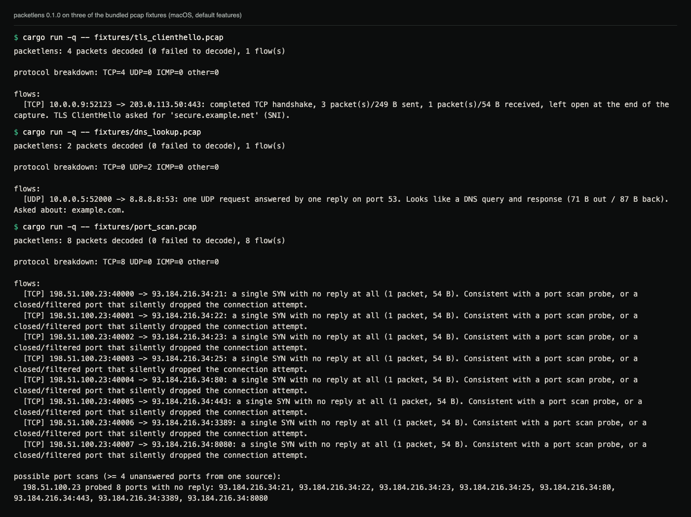
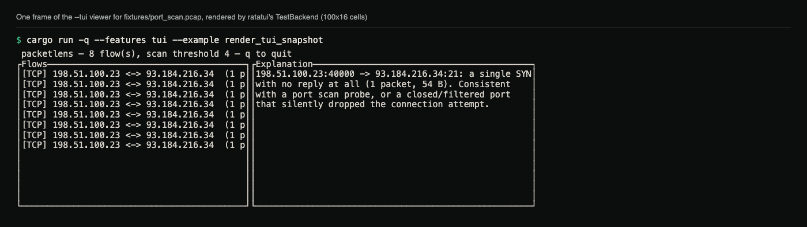
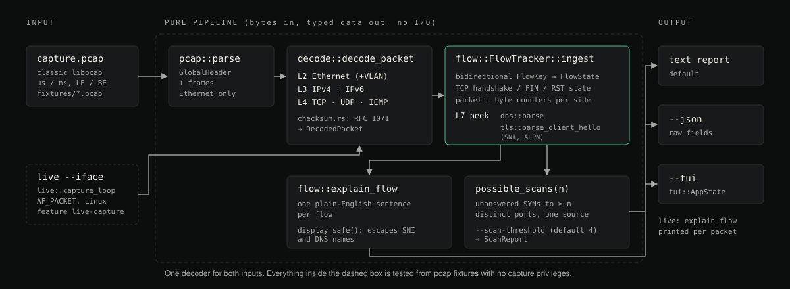

# packetlens

Decodes Ethernet, IPv4/IPv6, TCP/UDP/ICMP, DNS and TLS ClientHello from pcap
files, tracks connections, and prints one plain-English sentence per flow.
Written from scratch in Rust; it does not wrap Wireshark or libpcap.

[Case study ↗](https://hellpuff.dev/work/packetlens)

## Demo



Real output of the default build on three of the bundled fixtures. Each
flow gets one sentence; the port-scan fixture also triggers the scan
report.



One frame of the `--tui` viewer, rendered to text by the
`render_tui_snapshot` example through ratatui's `TestBackend`, so the
selection highlight is not visible.

```
$ cargo run -q -- fixtures/tls_clienthello.pcap
packetlens: 4 packets decoded (0 failed to decode), 1 flow(s)

protocol breakdown: TCP=4 UDP=0 ICMP=0 other=0

flows:
  [TCP] 10.0.0.9:52123 -> 203.0.113.50:443: completed TCP handshake, 3 packet(s)/249 B sent, 1 packet(s)/54 B received, left open at the end of the capture. TLS ClientHello asked for 'secure.example.net' (SNI).
```

## Why

Wireshark shows every field of every header. Often the question is simpler:
what is this flow doing? A completed HTTP request, a half-open port scan, a
DNS lookup, a TLS handshake to a particular hostname? packetlens decodes the
same wire formats but reports at that level, one line per connection, with
the raw fields available as JSON (`--json`).

The decode, connection-tracking and explanation pipeline is pure: bytes in,
typed data out, no I/O. It never opens a socket unless you run the separate
`live` subcommand. That is why the whole test suite (protocol decoding,
DNS/TLS parsing, scan detection, flow explanations) runs on Linux, macOS and
Windows CI with no capture privileges, against pcap fixtures committed to
the repo.

## What it supports

- Classic libpcap files (microsecond and nanosecond, either byte order) with
  Ethernet link type. pcapng and other link types are rejected with an error.
- Ethernet with 802.1Q VLAN tags, IPv4 and IPv6, TCP, UDP and ICMP. IPv4, TCP
  and UDP checksums are verified.
- Bidirectional connection tracking with TCP handshake and close state, and
  packet/byte counters per direction.
- DNS messages (questions and answers) and TLS ClientHello (SNI and ALPN)
  read from flow payloads.
- A port-scan heuristic: one source with unanswered SYNs to at least N
  distinct ports (`--scan-threshold`, default 4).
- Text report, `--json`, and an optional ratatui viewer (`--tui`).
- Live capture on Linux only, behind the `live-capture` feature.

## Quick start

Requires a Rust toolchain. The default build has no dependencies; the `tui`
feature pulls in ratatui and needs Rust 1.88 or newer.

```sh
git clone https://github.com/hellpuffyt/packetlens.git
cd packetlens
cargo run -- fixtures/port_scan.pcap
```

Output (trimmed: six of the eight flow lines are replaced by `...`):

```
packetlens: 8 packets decoded (0 failed to decode), 8 flow(s)

protocol breakdown: TCP=8 UDP=0 ICMP=0 other=0

flows:
  [TCP] 198.51.100.23:40000 -> 93.184.216.34:21: a single SYN with no reply at all (1 packet, 54 B). Consistent with a port scan probe, or a closed/filtered port that silently dropped the connection attempt.
  [TCP] 198.51.100.23:40001 -> 93.184.216.34:22: a single SYN with no reply at all (1 packet, 54 B). Consistent with a port scan probe, or a closed/filtered port that silently dropped the connection attempt.
  ...

possible port scans (>= 4 unanswered ports from one source):
  198.51.100.23 probed 8 ports with no reply: 93.184.216.34:21, 93.184.216.34:22, 93.184.216.34:23, 93.184.216.34:25, 93.184.216.34:80, 93.184.216.34:443, 93.184.216.34:3389, 93.184.216.34:8080
```

Machine-readable output:

```sh
cargo run -- fixtures/web_browsing.pcap --json
```

```
{"packets_decoded":7,"decode_failures":0,"flow_count":1,"flows":[{"protocol":"TCP","initiator":"10.0.0.5:51000","responder":"93.184.216.34:80","packets":7,"bytes":467,"summary":"10.0.0.5:51000 -> 93.184.216.34:80: completed TCP handshake, 4 packet(s)/253 B sent, 3 packet(s)/214 B received, closed cleanly with FIN. Looks like a plain HTTP request/response."}],"possible_scans":[]}
```

Interactive viewer (needs the `tui` feature):

```sh
cargo run --features tui -- fixtures/port_scan.pcap --tui
```

```
 packetlens — 8 flow(s), scan threshold 4 — q to quit
┌Flows──────────────────────────────────────┐┌Explanation──────────────────────────────────────────┐
│[TCP] 198.51.100.23 <-> 93.184.216.34  (1 p││198.51.100.23:40000 -> 93.184.216.34:21: a single SYN│
│[TCP] 198.51.100.23 <-> 93.184.216.34  (1 p││with no reply at all (1 packet, 54 B). Consistent    │
│[TCP] 198.51.100.23 <-> 93.184.216.34  (1 p││with a port scan probe, or a closed/filtered port    │
│[TCP] 198.51.100.23 <-> 93.184.216.34  (1 p││that silently dropped the connection attempt.        │
│[TCP] 198.51.100.23 <-> 93.184.216.34  (1 p││                                                     │
│[TCP] 198.51.100.23 <-> 93.184.216.34  (1 p││                                                     │
│[TCP] 198.51.100.23 <-> 93.184.216.34  (1 p││                                                     │
│[TCP] 198.51.100.23 <-> 93.184.216.34  (1 p││                                                     │
│                                           ││                                                     │
│                                           ││                                                     │
│                                           ││                                                     │
│                                           ││                                                     │
│                                           ││                                                     │
└───────────────────────────────────────────┘└─────────────────────────────────────────────────────┘
```

That frame (also in the Demo above) is rendered through ratatui's
`TestBackend` against `fixtures/port_scan.pcap` by
`cargo run --features tui --example render_tui_snapshot`. `j`/`k` or the
arrow keys move the selection; `q` or Esc quits.

### Usage

```
packetlens <capture.pcap> [OPTIONS]
packetlens live --iface <name>   (needs --features live-capture, Linux, root/CAP_NET_RAW)

OPTIONS:
    --json                 emit machine-readable JSON instead of text
    --tui                  open the interactive ratatui viewer (needs --features tui)
    --scan-threshold <N>   distinct unanswered ports before flagging a scan (default 4)
    -h, --help             print this help and exit
```

Running with no arguments prints this help and exits with status 2, as do
unknown options.

## Live capture

Live capture is implemented for Linux only and was not exercised for this
README; everything above was run against the bundled fixtures.

```sh
cargo build --release --features live-capture
sudo ./target/release/packetlens live --iface eth0
```

- **Linux**: `src/live.rs` opens an `AF_PACKET`/`SOCK_RAW` socket and prints
  the current flow sentence after each decoded packet. It needs
  `CAP_NET_RAW` or root: run as root, or
  `sudo setcap cap_net_raw+ep target/release/packetlens`. CI builds and lints
  this feature on Linux but does not run a capture.
- **Windows**: not implemented. Raw capture there needs
  [Npcap](https://npcap.com/) or a similar driver, which packetlens does not
  bundle or link.
- **macOS**: not implemented. BSD raw capture goes through BPF (`/dev/bpf*`)
  with its own permission model.

On Windows and macOS, `packetlens live` exits with status 1 and this message:

```
error: this build was compiled without live capture support.
Live capture is a Linux-only, elevated-privilege feature: rebuild with
`cargo build --features live-capture` on Linux and run with CAP_NET_RAW or root.
```

A new platform backend would only need a capture loop. It would feed the
same `decode::decode_packet` and `flow::FlowTracker` the pcap path uses;
there is one decoder in the codebase.

## Architecture



*Diagram of the decode pipeline, drawn from the functions named in `src/`.*

```
src/
├── pcap.rs      classic libpcap file reader (read-only; the fixture writer lives in examples/)
├── checksum.rs  RFC 1071 internet checksum (IPv4/TCP/UDP)
├── decode.rs    Ethernet/VLAN, IPv4/IPv6, TCP/UDP/ICMP decoding → DecodedPacket
├── dns.rs       DNS message parser (questions, answers)
├── tls.rs       TLS ClientHello parser (SNI, ALPN)
├── flow.rs      FlowTracker (connection state), explain_flow, possible_scans
├── lib.rs       analyze(): pcap::parse → decode every frame → FlowTracker
├── tui.rs       ratatui viewer (feature "tui")
├── live.rs      Linux AF_PACKET raw-socket capture (feature "live-capture")
└── main.rs      CLI: text/--json report, --tui, live subcommand
```

`pcap`, `checksum`, `decode`, `dns`, `tls` and `flow` do no I/O, which is
what lets them be unit- and fixture-tested without a capture backend.

## Tests

```sh
cargo test                    # 50 tests: 38 lib + 1 CLI unit, 8 fixture, 3 fuzz
cargo test --features tui     # 53: adds 3 tui::AppState unit tests
cargo test --test fixtures    # the 8 integration tests against fixtures/*.pcap
cargo test --test fuzz        # 3 deterministic robustness tests (mutated fixtures, random bytes)
```

The files in `fixtures/` are classic-format pcap files generated by
`examples/gen_fixture.rs`, which builds each Ethernet/IP/TCP/UDP/ICMP frame
byte by byte, including checksums computed with the same `checksum` module
the decoder verifies against.

| Fixture | Scenario |
|---|---|
| `web_browsing.pcap` | Full TCP handshake, HTTP request/response, clean FIN close |
| `port_scan.pcap` | 8 unanswered SYNs from one source across distinct ports |
| `dns_lookup.pcap` | UDP/53 A-record query and answer |
| `icmp_ping.pcap` | ICMP echo request/reply |
| `tls_clienthello.pcap` | TCP handshake plus a TLS 1.2-record ClientHello with an SNI extension |

CI runs `cargo run --example gen_fixture` and fails if the regenerated files
differ from the committed ones. Regenerating needs no network, root or Npcap.

## What this is not

- Not a Wireshark replacement: no dissector plugins, no deep inspection of
  arbitrary application protocols, no packet editing or replay.
- Not a decryption tool. The TLS parser reads only the plaintext
  ClientHello.
- Not a long-running monitor. Live capture keeps every flow it has seen in
  memory for the whole run.
- For traffic you are allowed to observe (your own interface, a capture you
  were given), not for intercepting anyone else's.

## Security

Captures are untrusted input. Every parser is bounds-checked and covered by
the robustness tests in `tests/fuzz.rs`, and names taken from packets (TLS
SNI, DNS queries) are escaped before they reach the terminal or the JSON
output. See [SECURITY.md](SECURITY.md) for the threat model and how to
report issues.

## Contributing

See [CONTRIBUTING.md](CONTRIBUTING.md).

## License

MIT. See [LICENSE](LICENSE).
